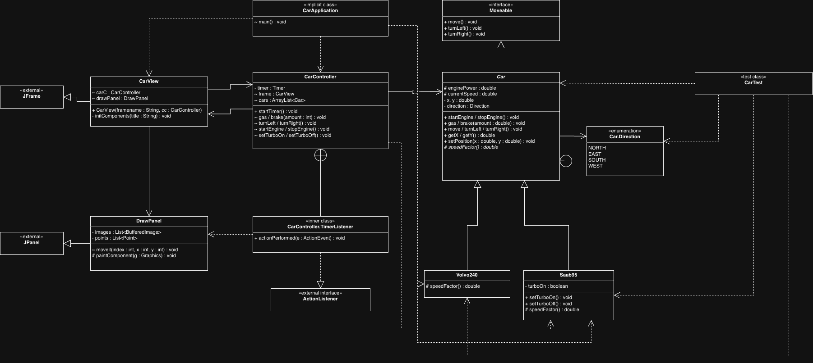

# Task 2: Dependencies

## Necessary dependencies
- `Volvo240`, `Saab95` → `Car` → `Moveable`, and `Car` → `Direction`: the model's inheritance design.
- One GUI class → the cars (to send gas, brake, turn commands).
- `CarView` → `DrawPanel` (the window contains the panel) and `CarView` → a controller (buttons need someone to call).
- `CarApplication` → the classes it creates; `CarTest` → the classes it tests; Swing superclasses.

## Dependencies that shouldn't exist
- `CarController` ↔ `CarView`: a cycle. Each holds a reference to the other.
- `CarController` → `DrawPanel`: reaches through the view (`frame.drawPanel.moveit(...)`) to update car positions.
- `CarController` → `Saab95`: `instanceof Saab95` for the turbo buttons.
- Hidden coupling: `DrawPanel` hard-codes the image paths and matches images to cars by list index, so it only works if `CarApplication` adds the cars in the same order.

## Dependencies stronger than necessary
- The GUI depends on concrete classes (`CarController`, `CarView`, `Saab95`) instead of interfaces (DIP).
- `CarView` depends on the whole `CarController`, but only needs the button commands.
- `CarController` holds the whole `CarView`, but only needs the panel to repaint.

## Other principle violations
- Law of Demeter: `frame.drawPanel.*` calls in `TimerListener`.
- OCP: adding a new car means editing `DrawPanel` (image paths) and possibly `CarController` (another `instanceof`).
- SRP / SoC: `CarController` handles button input, the timer, car movement, wall collisions and repainting.

## Summary
- Cohesion: high in the model, low in the GUI (`CarController` mixes input, timer and movement).
- Coupling: the model doesn't depend on the GUI, but the GUI is tightly coupled (cycle, reach-through, index matching).
- DIP: broken in the GUI; it depends on concrete classes rather than interfaces.
